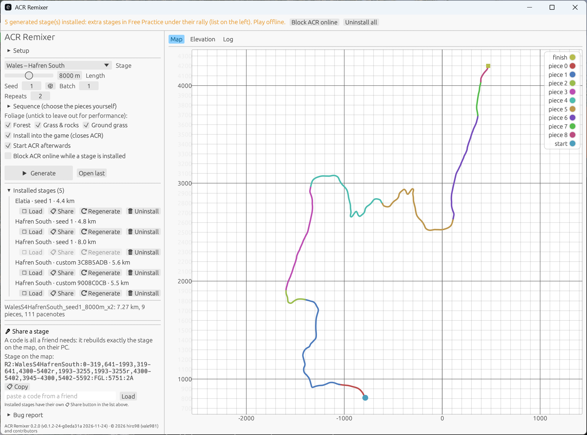
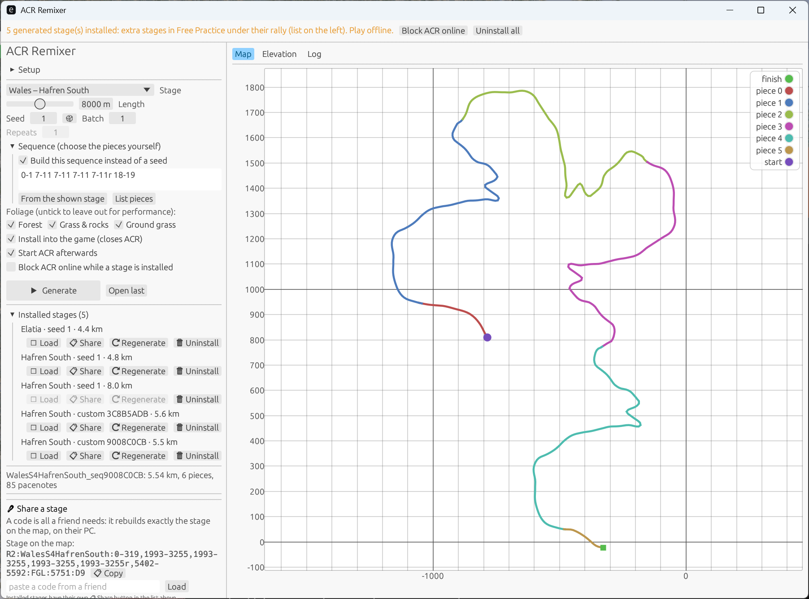
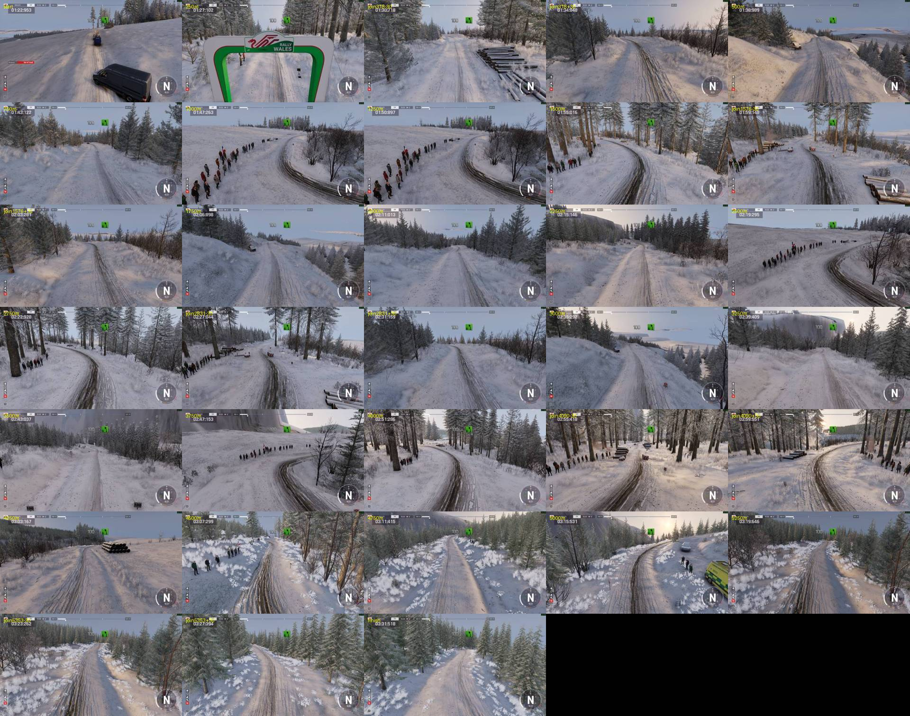

# ACR Remixer

[](../../releases)
[](../../releases/latest)
[](../../actions/workflows/nightly.yml)
[](LICENSE)
[](https://api.reuse.software/info/github.com/vale981/acr-remixer)

-c0392b)
[](#contributing)

**New rally stages for Assetto Corsa Rally, remixed from the stages you already own.**

ACR Remixer (formerly *acr-stagegen*) cuts the official stages into pieces and stitches them together in a
new order: new corners, new sequences, new pacenotes. Every seed is a different
stage. Everything comes from your own game install; nothing is downloaded.


> **Unofficial fan project.** Not affiliated with, endorsed by or supported by
> Kunos Simulazioni, Supernova Games Studios or the publisher of Assetto Corsa
> Rally. "Assetto Corsa" is a trademark of its owner. ACR Remixer contains no
> game files: stages are generated on your PC from your own copy of the game.
> Use it offline and at your own risk; it may stop working after game updates.

> **Status: early, good enough for practice.**
> Wales – Hafren South and Greece – Elatia work well. The other stages are
> marked *experimental*: they may look broken or be undrivable for now.

<a id="contributing"></a>

> **Contributions welcome!** Bug reports, ideas, good share codes and pull
> requests are all appreciated: open an
> [issue](../../issues) or a [pull request](../../pulls), or write to
> **acr-remix [at] protagon [dot] space**. For bugs, *Bug report → Export bug
> report* in the window writes one file with everything needed (your user name
> is hidden); please attach it.

---

## Quick start

1. **Download** `acr-remixer.exe` from the topmost entry on the
   [Releases page](../../releases): that's the newest build, either a version
   release (e.g. *ACR Remixer v0.1.0*) or the *nightly* with the latest changes,
   whichever is newer. It is a single file; there's nothing to install.
2. **Start it.** Windows may show a blue "Windows protected your PC" box
   because the program is not signed: click *More info* → *Run anyway*.
3. The program **finds Assetto Corsa Rally by itself** (through Steam). If it
   doesn't, open *Setup* and paste the game folder, e.g.
   `D:\SteamLibrary\steamapps\common\Assetto Corsa Rally`.
4. Pick a **stage**, a **length** and a **seed** (any number, or the 🎲 button),
   then press **▶ Generate**. A build takes about a minute; the bar shows what
   it's doing.
5. With *Install into the game* ticked, the new stage is installed automatically
   (ACR is closed first if it's running). Tick *Start ACR afterwards* to jump
   straight in.



## Driving your stage

Each generated stage is **added as an extra stage** next to the originals, under
the rally it was made from. For one made from Hafren South:

*Free Practice* → **Wales** → **Hafren South · seed 1 · 4.8 km** → start the session.

You can install as many as you like; the originals stay untouched. The window
lists the installed stages, each with its own *Uninstall* button.

## What you can use it for

- **Fresh stages to learn:** a new seed is a new stage with new corners and
  matching pacenotes, so you have to listen to your co-driver again instead of
  driving from memory.
- **Longer stages:** with *Repeats* above 1, pieces of the original stage may
  appear more than once, so a stage can be longer than the road it was made
  from (e.g. 8–13 km from Hafren South's 5.6 km).
- **Practising one hard section:** with a *Sequence* you choose the pieces
  yourself, so you can repeat one difficult piece many times in a row, e.g.
  `0-1 7-11 7-11 7-11 18-19` drives piece 7-11 three times, or
  `0-1 7-11 7-11r 7-11 7-11r 18-19` four times in alternating directions.
  Where the end of a piece doesn't line up with the start of the next, the
  join is bent smoothly (up to 45°) and the pacenotes there are made to match;
  sharper joins stay sharp, and the window warns about them.



## The options

| Option | What it does |
|---|---|
| **Stage** | Which official stage to take the pieces from. |
| **Length** | The length you'd like. Each source stage only has so much road, so the program picks the closest length that's possible. |
| **Seed** | The "recipe" number: change it for another stage. To share a stage, use its share code (below), not the seed: a new version of ACR Remixer may find a different stage with the same seed. |
| **Repeats** | How often a piece of road may appear. 1 = every piece at most once (stage length limited to about 90 % of the original); 2–3 = longer stages from repeated pieces. Each repeat costs some memory in the game. |
| **Sequence** | Optional: the exact pieces to drive instead of letting the seed decide, e.g. `0-1 7-11 2-7r 18-19` (numbers are the tile crossings, `r` = backwards). It starts filled with the last generated stage, so you can tweak that; the list next to it shows which pieces exist. Repeats are allowed as often as you like. |
| **Batch** | Builds several stages in a row (seed, seed+1, …), so you can compare them on the map. Each one is installed as its own stage. |
| **Forest / Grass & rocks / Ground grass** | Trees and plants along the road. Untick some if your PC struggles; the stage then looks barer but runs faster. |
| **Install / Start ACR** | Put the stage into the game automatically, and optionally start the game. |
| **Block ACR online while a stage is installed** | Optional. Adds a Windows Firewall rule that cuts ACR off from the internet while a generated stage is installed, and removes it again when you uninstall, so no times from a generated stage can reach the online leaderboards. Windows asks for admin rights each time the rule changes. |

While generated stages are installed, a bar at the top of the window says so,
with buttons to block ACR online or uninstall them all; the list of installed
stages in the window shows each one's map, and can load, share, regenerate
or uninstall it.

**Share codes.** Every stage you build gets a code, shown under *Share a
stage* and on the 📋 Share button of each installed stage:

```
R2:WalesS4HafrenSouth:0-1352,2451-3255,3255-4300,4656-5592:FG-:5751:EU
```

It lists the pieces of the original stage (in metres along its route, `r` =
backwards) and the foliage settings, so a friend who pastes it and presses
*Generate* gets exactly the same stage, also with later versions of ACR
Remixer. A check at the end catches typos, and if a game update changed the
original stage, the build warns. Codes from version 0.1.x
(`WalesS4HafrenSouth/4500/1/FGL`) only described the search settings; newer
versions find a different stage with them.

The **Map** tab shows the new route from above (each colour is one piece of an
original stage), **Elevation** shows the height profile with the joins marked,
and **Log** shows the details of the last build.

## What a stage looks like

A camera tour through a generated stage, from the start (top left) to the
finish: the practice sequence above, Hafren South's piece 7-11 four times,
with shots 30 m before and after every join:



## Good to know

- **It's a mod:** each stage adds a few files to
  `Assetto Corsa Rally\acr\Content\Paks\~mods`, plus one shared file with the
  menu entries. *Uninstall* removes them. Your original game files are never
  changed.
- **Online / leaderboards:** play generated stages offline and don't submit
  times from them; the optional firewall block helps with that.
- **Game updates** may break it until ACR Remixer is updated.
- Known rough edges: small seams at the joins, a visible edge where the start
  area meets the first piece, and a plain horizon: the distant hills of the
  original map are left out, because they'd float above the new ground.
- **Barrier tape** along the road is left out for now: its poles end up in
  different pieces and the tape would stretch across the map.
- **The same piece several times close together** (e.g. a practice sequence):
  where the copies lie side by side at different heights, the edge of the
  higher terrain can show as a steep wall in the distance.
- **Very long stages** may have short stretches without background ground far
  below the road (the build log names them under *filler coverage*).

---

## For developers

The GUI (`gui/`, Rust + [egui](https://github.com/emilk/egui)) runs the
generator backend (`stagegen/`, Python), which is embedded as a frozen exe in
release builds. Base-game files are Oodle-compressed; `oodle_shim/` provides an
open-source decompressor DLL (via
[oozextract](https://crates.io/crates/oozextract), MIT) so no proprietary Oodle
DLL is needed.

```
pip install -r requirements.txt                 # numpy, scipy (+ matplotlib for PNG previews)
python -m stagegen.cli list                     # levels in the install
python -m stagegen.cli build --level WalesS4HafrenSouth --length 4500 --seed 1 --out out --install
python -m stagegen.cli build ... --no-forest --no-grass --no-foliage   # leave foliage out
python -m stagegen.cli build ... --cfg seam_width=40                    # any WPConfig option
python -m stagegen.cli build --level WalesS4HafrenSouth --length 8000 --max-uses 2 --seed 1 --out out
python -m stagegen.cli segments --level WalesS4HafrenSouth              # pieces for --sequence (--json)
python -m stagegen.cli build --level WalesS4HafrenSouth --sequence "0-1 7-11 7-11r 7-11 18-19" --out out
python -m stagegen.cli installed                                        # installed stages
python -m stagegen.cli uninstall [--stage SG1L4500HafrenSouth]          # one or all
python -m stagegen.cli build ... --override                             # old mode: replace the original stage
```

Ideas that were looked into but not built yet (mixing stages, synthetic stages,
proper barrier tape, compression, open visual issues, ...) are collected in
[docs/IDEAS.md](docs/IDEAS.md), with what is known about each.

Tests:

```
pip install -r requirements-dev.txt
python -m pytest tests                  # everything; "game" tests read your local ACR install
python -m pytest tests -m "not game"    # synthetic only (what CI runs: no game files involved)
cargo test --manifest-path gui/Cargo.toml
```

Tests marked `game` find the install next to this folder or via `ACR_PAKS`
and skip themselves without one. Keep anything that reads game data behind
that marker, so no game content ends up in CI logs.

Release build (what `.github/workflows/nightly.yml` does):

```
cargo build --release --manifest-path oodle_shim/Cargo.toml
python -m PyInstaller packaging/backend.spec --distpath packaging/dist --workpath packaging/build
cargo build --release --manifest-path gui/Cargo.toml      # embeds packaging/dist/stagegen-backend.exe
```

In-game test automation (`tools/`): `acr_autotest.py` installs a build, starts
ACR, drives the menus with a virtual gamepad (ViGEmBus + vgamepad), drives off
the start line, then runs a camera tour via a UE4SS Lua mod and saves a contact
sheet, all hands-off.

### How a stage is built (`stagegen/build/wp.py`)

1. **Layout** (`tiles.py`): the source route is cut where it crosses the 350 m
   track-tile grid; pieces are joined grid line to grid line, so road and
   terrain meet edge to edge.
2. **Level**: tile actors, props, decals, crowds etc. move with their piece's
   rigid transform to a free area next to the original map; route splines,
   start/finish and splits are rebuilt; the RVT volume follows.
3. **Terrain**: each piece keeps the terrain it owns (Voronoi on the new
   layout); neighbouring pieces' terrain is blended at the seams; the coarse
   backdrop terrain is reshaped into filler ground under the whole stage.
4. **Foliage**: PCG forest and ground cover (HISM/ISM instances) are moved per
   instance; their cluster trees and cached bounds are rebuilt.
5. **Collision** (`DA_*BakedData`), **pacenotes** (forward/reverse tables) and an
   uncompressed IoStore container (`pakchunk99-<Level>_Stagegen_9_P`) that
   overrides only the rewritten packages.

### Reverse-engineered formats (`stagegen/extract/`, `stagegen/build/`)
- `iostore.py` IoStore TOC v8 reader; `zen.py` zen package header (5.5+ summary
  with cell maps); `unversioned.py` unversioned property headers (zero masks!).
- `bakeddata.py` / `writers.py` dmphysics BakedDataContainer (4 fields; meshes in
  metres, axes x,up,y), byte-identical round trip.
- `splines.py` DMSplineComponent curves; `pacenote_table.py` pacenote rows.
- `mesh_clip.py` / `hlod.py` cooked static mesh LODs; `foliage.py` (H)ISM
  instances, cluster trees, FBox / box-sphere bounds.
- `wp_hash.py` World Partition runtime spatial hash; `build/cityhash.py` CityHash64.

## Contributors

- [hiro98 (vale981)](https://github.com/vale981): author
- [iceone88](https://github.com/iceone88): zlib-compressed IoStore blocks,
  robust reading of the backend's output in the GUI

Want to be on this list? See [contributions welcome](#contributing).

## License

[GNU GPL v3 or later](LICENSE): © 2026 hiro98 (vale981) and the ACR Remixer
contributors. ACR Remixer is free software: use it, study it, change it and
share it. If you distribute it, changed or not, you have to pass on the same
freedoms: keep the copyright notices, mark your changes, and make the complete
source available under the GPL. Improvements are very welcome back here as
pull requests (see [contributions welcome](#contributing)). It comes without
any warranty.

Versions up to and including v0.1.2 were released under the MIT license and
remain available under it. Contributions received under MIT (by iceone88)
keep their MIT notice; the files containing them say `GPL-3.0-or-later AND
MIT`, and the MIT text is in `LICENSES/MIT.txt`.

This covers ACR Remixer's own code only. It contains no game files: everything
it builds comes from your own copy of Assetto Corsa Rally. The in-game
screenshots in `docs/` show the game's content, which belongs to its owners and
is not under these licenses. Every file's license is recorded following the
[REUSE](https://reuse.software) specification (SPDX headers, `REUSE.toml`,
`LICENSES/`). Third-party parts
keep their own licenses, e.g. [oozextract](https://crates.io/crates/oozextract)
(MIT) in `oodle_shim/`, [egui](https://github.com/emilk/egui) (MIT/Apache-2.0),
numpy and scipy (BSD).
